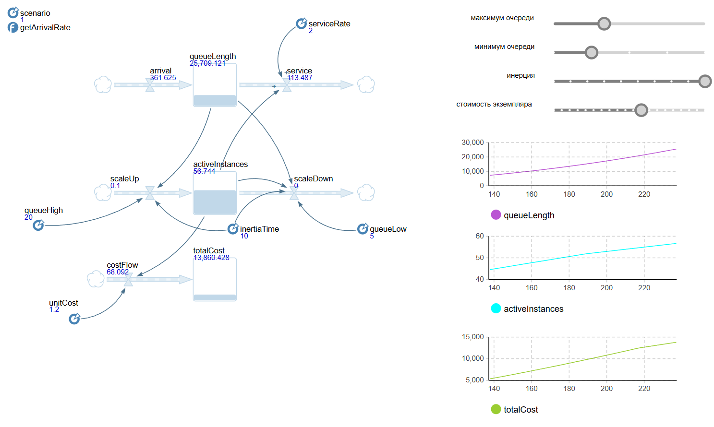

# **НАЦИОНАЛЬНЫЙ ИССЛЕДОВАТЕЛЬСКИЙ УНИВЕРСИТЕТ ИТМО**

## Факультет программной инженерии и компьютерных технологий

### _Моделирование систем_

### **Лабораторная работа №6**

---

**выполнил:** Шнейдерис Герардас

**преподаватель:** Русак Алена Викторовна

г. Санкт-Петербург

2026

## Задание

### Вариант 3.  Модель автоскейлинга с порогами и инерцией

__Задание:__ Исследуется работа веб-сервиса, обрабатывающего запросы, с очередью и пулом инстансов.
При росте очереди добавляются новые инстансы, при снижении — выключаются.
Запуск/остановка инстансов занимает время `dt`.

__Задачи:__
1) Создать `Stock` и `Flow`. Задать `arrivalRate` и `serviceRate` как параметры или константы. 
2) Реализовать логику скейлинга: условия на `queueLength` для `scaleUp` и `scaleDown`. 
3) Добавить `Delay` для изменения числа инстансов (моделирование инерции). 
4) Ввести накопление стоимости.
5) Добавить слайдеры для порогов, времени инерции, стоимости. 
6) Исследовать три сценария работы:  
  - Плавный рост нагрузки. 
  - Всплеск нагрузки (резкий скачок). 
  - Сезонные пики (периодические всплески). 
7) Рассчитать метрики и построить графики очереди, инстансов, накопления стоимости. 
8) Сделать выводы о балансе производительности и стоимости.

## Результаты моделирования

### Прогон 

Параметры

- `param`: value

## Выводы

- успех
